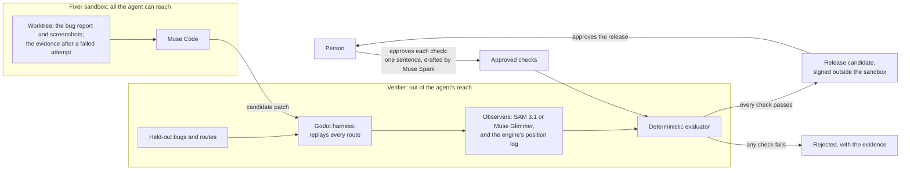

# Expectrail

**An AI coding agent says it fixed the bug. Expectrail plays the game and watches to find out.**

[expectrail.com](https://expectrail.com)

Expectrail verifies AI-agent changes by observation, not by trust. It replays the changed game, has
Meta's vision models (SAM 3.1, or the open-weight Muse Glimmer) find what a plain-English check names
in the frames, measures that against the engine's own record of where the robot, the coins and the
floor really are, and accepts the change only if every check passes: checks drafted by Muse Spark,
approved by a person, and kept where the agent cannot change them (it sees a failing check's spec
only after a failed attempt, and never sees the held-out ones).

It catches fixes that only look right. Given a "fix" that stops the robot falling through
the floor by drawing it sunk into the ground, a position-only check passed it, and Muse Code, shown
the before-and-after screenshots, said the fall was fixed. Expectrail saw the robot's feet below the
floor and rejected it. In our judge benchmark it accepted none of the 7 fixes that only look right
and turned down none of the 8 correct ones, in all three runs ([Results](#results)).

Every fix is also reviewed against its failing base: the same checks run on the game with the bug
and on the game with the fix, so the report shows the requested behavior failing before and passing
after, not only passing. In six live overnight runs, three on October 30 and three on October 31 on
the loop as it ships (Muse Code fixing from a plain report), each Muse Code fix was a demonstrated
repair, and the fix that sinks the robot was rejected with its requested checks still failing
([docs/review.md](docs/review.md)). Reviews with their real frames before and after the fix: one
run on the loop as it ships, [docs/review/report-first-run-1](docs/review/report-first-run-1/), one
from October 30, [docs/review/live-demo-run-1](docs/review/live-demo-run-1/), and the rejected fix
that sinks the robot, [docs/review/sinking-fix](docs/review/sinking-fix/).

We built and measured it on a game first, because a game shows the gap plainly: a change can pass
every test and still be visibly broken. Then, to see whether the engineering carries past one game,
we ran the same verifier on a web checkout page ([Beyond games](#beyond-games-a-web-checkout-page)). Built for the Meta Global AI Developer Hackathon (Indie
track), October 26 to November 4, 2026. Expectrail was called Nightshift until October 30; the old
names still work wherever a file or setting from before then turns up
([`expectrail/legacy.py`](expectrail/legacy.py)).

## The problem

Coding agents now change code faster than anyone can review it, and the usual gate, "the tests
pass", checks only what someone wrote a test for. Ask the agent whether its own fix worked and it
grades its own homework. Games show the gap most plainly: the demo game we use ships with no tests
at all, so existing checks catch none of our seeded bugs, and most of what goes wrong (a robot
falling through the floor, coins that are not drawn, a character hidden behind trees) shows only on
screen. Our first users would be teams that let coding agents change code their tests do not cover,
starting with game studios, where that gap is widest. Expectrail fits into the pipeline they already
have as one more gate; it does not replace their CI, their tests or their QA.

## How it works



1. **Play.** A harness replays a fixed route through the game and captures every frame, the same
   way every time.
2. **See.** Muse Spark turns a plain-English check ("the player never falls through the ground")
   into a structured test spec that a person approves once. SAM 3.1 (or Muse Glimmer) finds the
   objects the spec names, and the engine logs where they really are. A deterministic evaluator,
   not a model, decides pass or fail; a missing or uncertain observation is "needs review", never a
   pass.
3. **Fix.** Muse Code first gets a plain bug report: the failing check's sentence, screenshots of
   the failing run, the route and its log. If that attempt fails (the verifier rejects it, or it
   produces no fix in time), the next one gets Expectrail's evidence (the spec, the verdict, the
   first failing frame, and which public checks failed), and never anything about the held-out
   routes. Muse fixes most bugs from the report alone, but on October 31 it timed out on both
   sinking bugs until it had the evidence. The verifier is what stops a fix that only looks right,
   so it runs on every attempt ([docs/report-first.md](docs/report-first.md)). Muse patches the
   game in its own worktree. In the live runs it works inside bubblewrap: only that worktree is mounted (its
   project config read-only, an empty home), so the verifier's code, the held-out cases and the
   signing key are not in its filesystem at all. It keeps network access, because it has to reach
   Meta's API, and bubblewrap is a namespace sandbox on the host's kernel, not a VM. Where
   bubblewrap is not available, the fixer falls back to a worktree that does not contain those files.
4. **Verify.** A separate verifier rebuilds, replays, and runs the regression, gameplay, held-out
   and clean checks. It accepts a candidate only if every check passes, and it rejects a fix that
   only looks right, such as one that stops the fall by drawing the robot inside the ground. If the
   judge itself cannot answer (SAM down or out of credit), the same fix is judged again: by SAM
   once more, then by Muse Glimmer checked against the engine, labelled as such, then left for a
   person. A rejection is never sent to a second judge, and an outage never costs the fixer an
   attempt ([docs/fallbacks.md](docs/fallbacks.md)).
5. **Hand over.** Before-and-after frames, the diff, unresolved cases, and a release candidate
   signed outside the fixer's reach, for a person to approve. It can run overnight; the point is the
   sign-off, not the hour.

**Feedback goes in, but never straight to the fixer.** Muse Voice Transcribe turns a recorded
playtest into who-said-what. When Muse Spark sorts a remark as a bug and writes a one-line check
for it, that becomes a draft test spec that waits for a person's approval; raw speech never becomes
a spec. A request to weaken or switch off a check ("just turn the floor check off") is refused and
queued for a person, whether the fixed phrase rules or the model catch it. Inside the fixer, a
Muse Code hook blocks file-tool writes outside the editable files and logs every tool call (shell
commands are logged, not checked). The morning report lists both under "Feedback in" and "Refused
or blocked".
[docs/feedback-recording.md](docs/feedback-recording.md)

Status, October 30: the whole loop runs live, end to end: Wonder triage, Muse Code in a sandbox,
the Godot harness, the verifier with SAM 3.1 on the private held-out routes, the signed morning
report and the trust check. See [docs/new-work.md](docs/new-work.md) and
[agents/demo-path.md](agents/demo-path.md).

## Results

Every number here comes from a file in [`bench/`](bench), written from a CI run's own output, with
the command that reruns it. Four bug families (physics fall-through, missing texture, layering,
sinking), with two public development variants and two private held-out variants of each; the
detection benches replay every variant, and the clean game, on five routes. We wrote those bugs;
four more reproduce bugs other people reported ([Bugs we did not write](#bugs-we-did-not-write)).

| What we measured | Result | Run |
| --- | --- | --- |
| Held-out bugs caught, SAM 3.1 on | **8 of 8**, no false alarm on the clean game | [41003749744](https://github.com/seanudeke/Expectrail/actions/runs/41003749744) |
| Held-out bugs caught, Muse Glimmer checked against the engine, no SAM | **8 of 8**, no false alarm | [41003751876](https://github.com/seanudeke/Expectrail/actions/runs/41003751876) |
| Held-out bugs caught with no vision model (engine and gameplay checks only) | 4 of 8 | the same two runs |
| Development bugs caught: SAM on / Glimmer, no SAM / no vision | 8 of 8 / 8 of 8 / 3 of 8 | [40841977642](https://github.com/seanudeke/Expectrail/actions/runs/40841977642), [41001182605](https://github.com/seanudeke/Expectrail/actions/runs/41001182605) |
| Publicly reported Godot bugs, reproduced (not written by us), caught: today's checks with SAM off / engine-record checks | 0 of 4 / **4 of 4**, no false alarm on the clean game; the engine-record checks were written after the bugs were reproduced | [41116202685](https://github.com/seanudeke/Expectrail/actions/runs/41116202685) |
| Natural-catch trial: Muse Code given each reported bug in the reporter's words, 5 times each (20 cases) | 20 of 20 fixed on the first attempt; Expectrail accepted 20, the bug's own check passed 20, Muse from screenshots accepted 19; **0 natural catches** | [41129722699](https://github.com/seanudeke/Expectrail/actions/runs/41129722699) |
| Bad fixes that only look right, accepted by the judge (7 cases, 3 runs) | Expectrail with SAM **0 of 7**; Expectrail without SAM 3 of 7; Muse from screenshots 2 of 7; Expectrail with Muse Glimmer checked against the engine, no SAM (1 run) 0 of 7, one of them stopped only on a held-out route | [judge](bench/judge/README.md), [with Glimmer](bench/judge/glimmer/README.md) |
| Good fixes accepted by the judge (8 cases, 3 runs) | Expectrail 8 of 8 every run, with Glimmer too; Muse from screenshots 6, 7 and 6 of 8 | [judge](bench/judge/README.md), [with Glimmer](bench/judge/glimmer/README.md) |
| Development bugs fixed by Muse Code, October 30 | 8 of 8 with Expectrail's evidence; 8 of 8 from screenshots alone | [fix matrix](bench/fix-matrix/README.md) |
| Development bugs fixed by Muse Code, October 31, all three briefings | Evidence first **8 of 8**; report first, evidence after a failed attempt 7 of 8; report only 6 of 8. Every miss was a sinking bug where the report-only attempts timed out | [41223754703](https://github.com/seanudeke/Expectrail/actions/runs/41223754703) |
| Demo path, live, end to end, 10 independent runs | **10 of 10 accepted**, each on the first attempt; 12 to 22 minutes a run (median 14.5) and 1,164 SAM images ($2.91) a run; Muse Code's share is not reported per run | [40990485265](https://github.com/seanudeke/Expectrail/actions/runs/40990485265) |
| Demo path, live, after the report-first change (Muse gets the plain report first), 3 runs | **3 of 3 accepted**, each on the first attempt from the report; each fix's review: repair demonstrated; 7 to 12 minutes and 157 SAM images ($0.39) a run, with the clean game's SAM answers shared | [41223748922](https://github.com/seanudeke/Expectrail/actions/runs/41223748922) |
| Meta Model API spend, whole team, through October 29 | $204 (SAM images at list price are almost all of it) | [cost](bench/cost/README.md) |

### Who catches a fix that only looks right

Each of these stops the reported symptom, or claims to, and each is wrong. The same candidate patch
went to three judges, in three runs: Expectrail with SAM, Expectrail with the position log only (no vision),
and Muse Code looking at before-and-after screenshots ([`bench/judge/`](bench/judge/README.md), and the
third run in [`bench/judge/glimmer/`](bench/judge/glimmer/README.md)). Every decision was the same in
all three runs except one of Muse Code's, on a correct fix.

| The candidate fix | Expectrail with SAM | Expectrail, position log only | Muse Code from screenshots |
| --- | --- | --- | --- |
| Stops the fall but draws the robot inside the ground | reject | **accept** | **accept** |
| Stops the fall by moving the floor's collision below its art | reject | reject | **accept** |
| Stops the fall but draws the robot behind the level art | reject | **accept** | reject |
| Shows the robot by deleting every tree | reject | **accept** | reject |
| Stops the fall by freezing the robot | reject | reject | reject |
| Changes only a comment; the robot still falls | reject | reject | reject |
| Stops the sinking but leaves the robot floating | reject | reject | reject |

The first row is the one to remember: a model looking at the same pictures said the fall was fixed,
and only the measured check against the clean game said no. On the 8 correct fixes, Expectrail with
SAM accepted all 8 in all three runs, and it accepted all 10 live runs of the demo path: 34 judgments of a
correct fix, none rejected. Muse Code from screenshots turned down one correct fix in every run and
another in two of the three.

The third run (October 31) added a fourth judge, Muse Glimmer checked against the engine, with no
SAM. It accepted all 8 correct fixes and none of the 7. One of the seven, the deleted trees, passed
every public check under Glimmer and was stopped only on a held-out route; SAM stops it on the
public visibility check. So Glimmer is the fallback for when SAM does not answer, not its equal
([docs/open-weights.md](docs/open-weights.md)).

What these numbers do and do not say:

- **The verifier is where Expectrail wins, not the fixer.** On October 30 Muse Code fixed all 8
  development bugs from screenshots alone, as well as with our evidence. What screenshots alone cannot do is judge:
  Muse from screenshots accepted 2 of 7 fixes that only look right (one lowers the floor, one sinks
  the robot) and turned down one or two good ones. Expectrail with SAM accepted none of the bad and
  all of the good, in all three runs. So since October 30 the fixer gets a plain report first, every
  attempt is verified, and Expectrail's evidence goes to the fixer after a failed attempt. The
  evidence still matters for fixing on the subtle bugs: on October 31 it fixed both sinking bugs
  on the first attempt, where the report alone timed out
  ([docs/report-first.md](docs/report-first.md) has the decision, its evidence and that amendment).
- **One held-out catch came after a miss.** The first held-out runs caught 7 of 8. The eighth
  (sinking/v4) draws the floor away from where it collides, and every check measured the robot
  against the collision. The ground check now also follows the floor as drawn. It was built after
  the miss, from the public game, without reading that variant's patch, so it is a check made for
  the class that was missed, not a blind catch ([docs/sam.md](docs/sam.md),
  [`bench/drawn-floor/`](bench/drawn-floor)).
- **Two families need vision.** Missing texture and layering pass every engine and gameplay check;
  only the vision checks catch them, on every route.
- **This is a small, controlled benchmark.** Fifteen candidate fixes, the bad ones written by us to
  look right, and judges that see different evidence by design (the comparison is whether
  independent evidence beats a model's reading of screenshots). It is evidence for this game and
  these bugs, not a measure of robustness to any fix an agent might write.
- **There is no manual baseline.** We have not timed a person doing the same work, so we make no
  claim about hours saved.

### Bugs we did not write

Every bug above was written by our team. A teammate wrote the held-out ones away from the checks,
but "you planted bugs your own tool can see" is a fair objection. So we reproduced four bugs that
other people reported: two that Godot contributors fixed in this very demo (jumping in mid-air,
2016; the gun's cooldown never restarting, 2022) and two reported in other developers' Godot games
(a script that flips the robot's body instead of its sprite, godot#78613; an enemy whose floor rays
start inside the floor, so it walks off ledges). We wrote the patches that put them back; the bug,
its symptom and its cause come from the cited reports ([`bugs/reported/`](bugs/reported/README.md)).
Each was rendered on five routes, and so was the clean game ([`bench/reported/`](bench/reported/README.md)).

| Checks | Caught | False alarm on the clean game |
| --- | --- | --- |
| Today's verifier, SAM off (engine ground, gameplay) | 0 of 4 | none |
| Engine-record checks (five one-sentence rules on the harness trace) | **4 of 4** | none |

- **Today's checks miss all four.** They check that the robot stays above the ground and keeps
  moving, and none of these bugs breaks that. This is "it checks only what someone wrote a check
  for", measured. The approved specs also judge only the first two seconds of a route (frames 0 to
  119, the window they were approved with); the gameplay check reads the whole run. We did not pay
  for SAM on these: its specs ask whether the robot and the coins are visible in those same two
  seconds, and the climb and the enemy's fall come later.
- **What caught them is more of the engine's record, not more model calls.** The harness now logs
  which way the robot's sprite faces, every enemy and every bullet. Five rules read that log: the
  robot never rises more than a double jump above the floor it left, it faces the way it walks,
  bullets go the way it faces, the gun fires at most every 0.25 s, and no enemy falls more than a
  tile. Each bug fails its own rule on its own route; nothing fails on the clean game.
- **The rules were written after we reproduced the bugs,** so this shows the bugs are now visible
  to Expectrail, not that it would have found them blind, and the verifier does not run the rules
  yet.
- **The natural-catch trial found nothing to catch.** The test that would count is a fix Muse Code
  writes that looks right but is wrong, rejected by Expectrail. So we committed the rules, and a
  digest of guards kept with the held-out set (the double jump still works, the gun still fires,
  the enemies still patrol), before the run. Then we gave Muse Code each bug in the reporter's own
  words, five times. It fixed all 20 cases on its first attempt, including the jump bug, where the
  2016 fix ("only jump on the floor") would also have deleted today's double jump. Expectrail
  accepted all 20, each bug's own check passed all 20, and no guard fired, so on these bugs the
  extra checks changed nothing. The one disagreement: Muse from screenshots rejected one body-flip
  fix that Expectrail accepted; we have not yet read that patch to say which judge was right
  ([`bench/reported/trial.md`](bench/reported/trial.md)).
- **Reproducing them turned up a live upstream regression.** A 2024 art remake of the demo partly
  undid an earlier fix to the platforms' drawing order (PR #927), so in the current demo the lower
  moving platform draws behind the ground's grass edge. It is a candidate report to the demo's
  maintainers, not a benchmark case.

**Open weights.** Muse Glimmer 30B, on a Fireworks deployment, can judge every vision check with no
SAM key, checked against the game engine (`glimmer-engine`): 8 of 8 held-out and 8 of 8
development bugs caught, no false alarm, and on the held-out routes the real fix is accepted and the
hide-the-robot fix rejected. Muse Spark Open, on Baseten, drafts test specs and sorts playtester
feedback (`--endpoint open`, `--sorter open`). Live on October 30, its drafts of our three checks
were valid, and its ground draft gave the approved spec's verdict on all 9 seeded runs, after we
fixed a prompt that let it read the boundary the wrong way round. It sorted the scripted playtest
the way the rules do and flagged both requests to switch a check off. Its drafts still need a
person to tighten the object prompts, as Muse Spark's do ([`bench/spark-open/`](bench/spark-open)).
SAM 3.1 stays the default: Glimmer's boxes are too loose for the ground check, so without SAM the ground is
judged on the engine's position log, and a Glimmer bench takes about eight times the job minutes.
[docs/open-weights.md](docs/open-weights.md)

### Beyond games: a web checkout page

This is supporting evidence, not the product: the same verifier pointed at a second kind of
software. The page is Bootstrap 5.3.8's checkout example, unmodified ([`apps/checkout`](apps/checkout)).
Chromium replays a shopper filling in the form on a desktop and on a phone, one frame per step, and
two replays produce the same frames byte for byte. The page's layout boxes stand in for the engine's
position log, and "did the order go through" stands in for the gameplay check. We seeded four bug
families of the same kinds into the page and wrote three one-sentence checks. The evaluator, the
contracts, the decision rule, SAM 3.1, and the fixer and its sandbox are unchanged. The new parts
are the harness ([`harness/web`](harness/web)), the checks, the bugs, and one rule for the vision
checks, described below: a SAM box counts only where the page drew the element.

| What we measured | Result | Run |
| --- | --- | --- |
| Development bugs caught: SAM on / SAM off | **8 of 8** / 4 of 8, no false alarm on the clean page | [41109233666](https://github.com/seanudeke/Expectrail/actions/runs/41109233666) |
| Private bugs caught (4, written by a separate agent that never saw the checks): SAM on / SAM off | **4 of 4** / 2 of 4, no false alarm | [41130091655](https://github.com/seanudeke/Expectrail/actions/runs/41130091655) |
| Changes that only look right, accepted (5 cases) | Expectrail with SAM **0 of 5**; without SAM 3 of 5; a pixel diff against the clean page 0 of 5 | [judge](bench/web/judge.md) |
| Good changes, accepted (the correct fix, 3 intended changes, Muse Code's live fix) | Expectrail **5 of 5**, with or without SAM; the pixel diff 1 of 5 | [judge](bench/web/judge.md) |
| Live repair matrix: 8 bugs, with Expectrail's evidence and from screenshots alone | **16 of 16 fixed**, each accepted on the first attempt with SAM on, on the public and the private sessions; 2,209 SAM images ($5.52), 46 job minutes | [fix matrix](bench/web/fix-matrix/README.md) |

What this does and does not show:

- **Without vision, half the bugs get through our layout checks.**
  - Four of the eight pass every layout and behaviour check: a bar that covers the button but lets
    clicks through, a transparent button, a broken logo, and a button moved out of the form by a
    transform.
  - Three of the five changes that only look right get past the checks without SAM.
  - A pixel diff rejects every bad change, but it also rejects every intended one, because it
    cannot tell a change someone asked for from a broken one.
  - A stronger page-only check could catch more of these: occlusion tests, computed styles, image
    load state. That would need code for each way a page can break. With SAM, one sentence per
    element checks what a shopper would see.
- **SAM alone was not enough on the web. Our first fix for that was wrong.**
  - On the phone, any prompt for the button also matched the cart's count badge or the theme
    toggle. So with the real button gone, "button visible" could still pass.
  - We first set a score threshold between the look-alikes and the button. It looked right on the
    bugs: 8 of 8 caught, no false alarm.
  - Then it rejected Muse Code's first live fix, which was correct. With the bar moved just below
    the button, SAM found the button where the page drew it but scored it 0.56, under the 0.71
    threshold.
  - The check now counts a SAM box only where it overlaps the page's own paint box for that
    element. A look-alike elsewhere cannot pass for the button, and SAM still has to see the
    element drawn there, so a covered or transparent button still fails.
  - With that rule, the prompt "blue checkout button" found the drawn button on every probed frame
    (lowest 0.65) and nothing on a covered, transparent or off-screen one. The default threshold is
    used.
  - The cost: the vision check now leans on the page's geometry, so it is not independent of the
    page the way the game's SAM checks are of the engine. Every step, including the threshold that
    failed, is in [`bench/web/`](bench/web).
- **Running it live found a second fault.** The first full repair run rejected Muse's correct fix
  for fall-through v1 on the private sessions alone.
  - With SAM, the clean page itself failed "the button stays inside the form" there. The button
    is flush with the form's edges, and SAM's box ran past the 4 px tolerance at that screen size.
  - The preflight that clears the private sessions before a run had used no model, so it missed
    this. It now runs SAM.
  - The tolerance is now 18 px, halfway to the 36 px the sinking bugs move the button, chosen from
    the public sessions.
- **The repair matrix shows the loop working, not a better fixer.** Muse Code fixed all 8 bugs from
  screenshots alone, just as it did with our evidence, as it did in the game's October 30 run.
  - Every fix it wrote is a real fix: it removes the bad rule, corrects the logo path, or moves the
    bar clear of the button.
  - The verifier accepted all 16, on the public and private sessions. Two of those cases are the
    ones that exposed the faults above, so they are not independent tests of the fixed checks.
  - The repair loop ([`agents/web_fix.py`](agents/web_fix.py)) uses the game's fixer and sandbox
    unchanged.
- **Tuned mostly on what it is scored on.** The prompts, the rule and the tolerance were chosen on
  public bugs and changes we wrote, plus Muse's fixes.
  - The first test on bugs they were not tuned on is four private bugs. A separate Claude agent wrote
    them, given only the page, the public bugs and the four things a shopper should get. It never
    saw the checks or how they were tuned, and we have not read its patches.
  - SAM caught all four; without SAM, two.
  - But that agent is the same model family as the one that tuned the checks, not a person, and
    four is a small set.
  - The two private web sessions are only replays of the same page, written by Sean. Their screen
    sizes came from a list we suggested.
- **One static page, three checks, written by the team that built the verifier.** It shows that
  the harness can be replaced while the rest stays fixed. It does not show that Expectrail works on
  any web app.

## What Expectrail cannot do yet

- **It checks a change; it does not explore.** It replays fixed routes, so a bug where no route goes
  is invisible to it. Today it is visual regression checking, not playtesting.
- **It checks only what someone wrote a check for.** Three approved checks in the verifier today. Nothing
  checks what nobody described: today's checks caught none of the four reported bugs. Advisory
  discovery ([docs/discovery.md](docs/discovery.md)) is the first answer: 22 generic probes judged by
  contracts read from the game's code found all four, each 3 times out of 3, with no false alarm on
  the clean game, locally and in CI. It does not gate anything, and its profile was written after
  reading those four reports (development reproduction, not blind discovery). On the eight
  development bugs it was not written for, it flagged the two fall-through variants by a symptom and
  missed the six that are visual or about ground contact.
- **One game and one web page, mostly with bugs we seeded.** The game's held-out bugs were kept from
  the fixer, but a teammate wrote them, and the same team wrote the checks. The four reproduced
  public bug reports are caught only by engine-record checks written after we saw them, which the
  verifier does not run yet, and in a 20-case trial Muse Code wrote no fix for them that only
  looked right, so there is no blind catch on a real bug yet. The checkout page's four private bugs
  came from a separate agent that never saw its checks, but of the same model family that tuned them.
- **Mostly repairs.** The web judge includes three intended changes. We have not run the agent on
  features, refactors or dependency updates, or on software without a screen. The design is meant
  to carry over; [docs/future-work.md](docs/future-work.md) says which parts would and which would
  not.
- **The fixer's sandbox is not a hard boundary.** It has network access and shares the host's
  kernel, and without bubblewrap it is only a worktree without the verifier's files.
- **No measured comparison with doing it by hand,** and one held-out catch (sinking/v4) came from a
  check built after that bug was first missed.

Known limits in more detail, and what we would build next: [docs/future-work.md](docs/future-work.md).

## Interactive Hosted Demo

Explore the complete Gate 2 audit vault and interactive defect-fix explorer without spending Meta API credits:

The replay in this page is an animated illustration of each case, not frames captured from the
game. The measured results are under [Results](#results) and in [`bench/`](bench), and the captured
frames are in each run's artifacts.

- **Local Preview:**
  ```sh
  python3 -m http.server 8000 --directory docs/demo
  # Open http://localhost:8000 in your browser
  ```
- **Live / Static:** Open [`docs/demo/index.html`](docs/demo/index.html) directly in any modern browser.
- **Features:**
  - **Case Explorer:** Switch across all 8 development defect variants (physics fall-through, missing textures, layering, sinking) and 4 rejected anti-cheat exploits (freezing player, hiding player, sinking player, lowering the floor).
  - **Visual & HUD Simulation:** An illustrated replay with coordinate traces, floor boundaries and SAM 3.1 boxes drawn over it.
  - **Audit Breakdown:** Complete 4-suite verifier checks (`regression`, `gameplay`, `clean`, `held-out`).
  - **Benchmark Matrix:** development set: 8 of 8 bugs caught with SAM, 3 of 8 without; 8 of 8 fixed both from screenshots and with Expectrail (see [`bench/`](bench)).
  - **Security & Trust:** Visualizes "Deny-by-absence" isolation and canary probe denials.
  - **Morning Report & Release Candidate:** 7:30 AM rollup and Ed25519 signature audit.

## Try it

Requires Python 3.10+, and for capture, Linux with `xvfb-run` and Mesa (no GPU needed).

```sh
python3 -m pip install -r requirements-dev.txt
python3 -m unittest discover -s tests -t .                  # contracts and evaluator

./harness/get_godot.sh                                       # Godot 4.7.2, SHA-512 checked
python3 -m harness.run --route harness/routes/smoke.json --out runs/smoke
python3 -m harness.run --route harness/routes/smoke.json --out runs/fall \
  --patch bugs/physics-fall-through/v1.patch                 # the same route with a seeded bug
python3 -m harness.replay_check --route harness/routes/smoke.json --runs 10

python3 -m expectrail.evaluator --spec contracts/examples/test-spec.json \
  --observations contracts/examples/observations.json       # decide a check

python3 -m agents.gate1 --out runs/gate1 --skip-harness \
  --observations agents/fixtures/obs-fixed.json             # repair → fix → verify
python3 -m agents.loop --out runs/loop --mode offline --runs 10
# → runs/loop/morning-report.md (rollup) + per-run before/after frames
python3 -m agents.trust --out runs/trust                    # signing key stays off the fixer

# Local Meta keys: copy .env.example → .env (gitignored) and set META_API_KEY / MODEL_API_KEY
python3 -m expectrail.spec_writer draft "The player never falls through the ground" --out /tmp/spec.json
python3 -m expectrail.spec_writer approve /tmp/spec.json --by <you>   # Muse Spark drafts; a person approves
python3 -m agents.feedback --offline --transcript agents/fixtures/feedback/playtest-transcript.json \
  --fixture agents/fixtures/feedback/spark-fixture.json --out runs/feedback   # feedback → draft specs
python3 -m agents.loop --out runs/loop --mode offline --feedback runs/feedback/feedback-intake.json
# Live feedback: python3 -m agents.feedback --audio playtest.wav --consent --out runs/feedback
python3 -m agents.film_feedback --out runs/film-feedback   # hostile-feedback beat → film.md
# Open weights: add --sorter open (Muse Spark Open on Baseten, BASETEN_API_KEY) to agents.feedback
# Live Muse film (clean prompt): python3 -m agents.prove_live --out runs/prove
# Live overnight path: python3 -m agents.loop --mode live
```

See [agents/README.md](agents/README.md) for Muse API / Muse Code setup (`.env`, `META_API_KEY`).

## Layout and lanes

| Path | What | Lane |
| --- | --- | --- |
| [`contracts/`](contracts) | Schemas and examples for everything passed between lanes ([docs](docs/contracts.md)) | everyone |
| [`harness/`](harness) | Route player, Movie Maker capture under Xvfb, replay check ([docs](docs/harness.md)) | Timo |
| [`expectrail/`](expectrail) | Contract helpers, the reference evaluator, and the Muse Spark spec writer | Zayyad, Sean |
| [`expectrail/trace/`](expectrail/trace), [`expectrail/discovery/`](expectrail/discovery), [`discovery/`](discovery) | Advisory discovery: episodes, the trace-contract interpreter, generic probes, the mechanics profile, the Muse Spark planner ([docs](docs/discovery.md)) | Sean |
| [`specs/`](specs) | Test specs for the bug families; a person approves each one | Sean |
| [`bugs/`](bugs) | Seeded bugs, and reproductions of publicly reported Godot bugs ([`bugs/reported/`](bugs/reported/README.md)), as patches against the clean game ([evaluation plan](docs/evaluation.md)) | Sean, Timo |
| [`docs/demo/`](docs/demo/) | Interactive demo showcase and audit vault web app | Timo |
| [`game/`](game) | Godot's 2D platformer demo, unmodified (MIT) | prior work |
| [`agents/`](agents) | Repair requests, Muse Code fixer, verifier, Wonder triage, morning report | Taofeek |

## Gates

- **Gate 1, October 28:** one seeded bug caught by a visual assertion, fixed by Muse Code in a
  fixer worktree without verifier secrets mounted, and accepted by the protected verifier, end to
  end on one level.
- **Gate 2, November 1:** three bug families with four variants each, clean and held-out cases, the
  benchmark against a Muse Code with screenshots baseline, the morning report, and a demo path that
  passes 10 runs in a row.

## Prior work and rules

The game is Godot's MIT-licensed demo, imported unmodified in its own commit
([game/README.md](game/README.md)). Seeded bugs and fixes are patches, never edits to the clean
game. Everything else in this repository was written during the event, and
[docs/new-work.md](docs/new-work.md) lists it by date.

## License

[Apache License 2.0](LICENSE). See [NOTICE](NOTICE) for third-party work.
