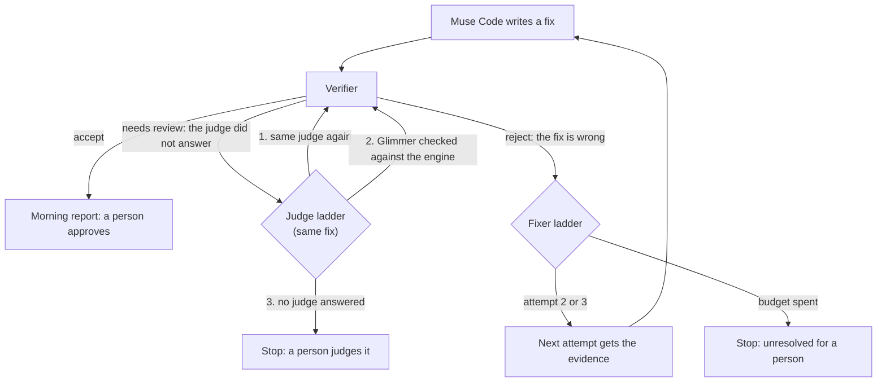

# Fallbacks: two ladders, never mixed

Decided October 30, 2026. When the overnight loop does not get an accepted fix, there are only two
possible reasons, and each has its own ladder:

- **The fix is wrong.** The verifier rejected it. This is the fixer ladder.
- **The judge did not answer.** SAM was down, timed out, was rate-limited or ran out of credit, so
  the verifier could only say "needs review". This is the judge ladder.

The ladders never mix. A wrong fix is never sent to a second judge, and an outage never costs the
fixer an attempt.

## The fixer ladder: the fix is wrong

[report-first.md](report-first.md) has the reasoning. In short:

1. The first attempt gets a plain report.
2. After a failed attempt (rejected, timed out or changed nothing), the next attempt gets
   Expectrail's evidence, and after a rejection the public checks that failed, never a held-out
   route or its reason.
3. After the third attempt, the loop stops. There is no release candidate, and the morning report
   lists the case under "Unresolved for a human" with the verifier's reasons.

## Before anything is spent: the pre-run check

[`agents/sam_health.py`](../agents/sam_health.py). The likeliest real failure is SAM running out of
credit, and no retry fixes an empty balance. So a live run with SAM on sends SAM one image first, the
committed frame `agents/fixtures/frames/after-fixed.png`, past the answer cache, since a cached answer
says nothing about SAM today. If SAM does not answer, the run stops before Wonder or Muse Code spends
anything, and the morning report says "SAM did not answer before the run" and why. Nothing is signed,
because nothing was verified. A run with SAM off, on Glimmer checked against the engine, or on
fixtures alone sends nothing. The check does not reach Glimmer: an outage that starts after it is
the judge ladder's.

The kinds are `auth`, `credit`, `rate-limit`, `server`, `network`, `request` and `unknown`
(`agents.sam_observations.SamError`). Meta's out-of-credit reply has never been observed, so `credit`
means a 402, or a 403 or 429 whose body speaks of credit, billing, balance, payment or an insufficient
quota. A per-minute quota is a `rate-limit`.

## The judge ladder: the judge did not answer

[`agents/judge_ladder.py`](../agents/judge_ladder.py). It climbs only when the verifier failed no
check and an observer error says a vision model did not answer ("sam observations unavailable").
Every step judges the same candidate again; the fixer is not asked for anything.

1. **The same judge again**, after a short wait (`EXPECTRAIL_JUDGE_RETRY_WAIT`, 30 s), for an
   outage that has passed by then, such as a rate limit. This step is skipped when the error says
   `auth` or `credit`, which waiting does not fix. An unknown error keeps the retry.
2. **Muse Glimmer checked against the engine** (`glimmer-engine`), when a Glimmer deployment is
   configured (`EXPECTRAIL_GLIMMER_API_KEY` or `FIREWORKS_API_KEY`, and `EXPECTRAIL_GLIMMER_MODEL`)
   and it wakes within `EXPECTRAIL_GLIMMER_WARM_TIMEOUT` (600 s). It is never Glimmer alone.
   - **The deployment is read first, and nothing is woken.** The ladder reads it through Fireworks'
     control plane, which sends no frame. If it is scaled to 0 replicas, because a person scaled it
     down or the account was suspended, it cannot answer. The step is skipped at once rather than
     waited on.
   - **The ladder never changes a deployment's scaling.** That spends money, and it is a person's
     decision (`python -m agents.fireworks_deployment --restore`).
   - In every other case where the step cannot run, it is skipped too, and the skip and its reason
     are recorded.
3. **Stop.** The candidate stays "needs review". No further fix is attempted, because the fix may
   well be right. The morning report says which judges were tried and that a person must judge
   the candidate.

When Glimmer decides, the morning report says so for the person who approves the release. Glimmer's
boxes are too loose for the ground check, so the ground was judged on the engine's position log, not
on SAM's view of the robot. A robot drawn inside the ground is what to look for in the after frames.

## Drills

A fallback that has never run is a guess. `EXPECTRAIL_JUDGE_DRILL` makes SAM requests fail the way an
outage does, before any cache:

- `sam-unavailable`: SAM is down from the start, so the pre-run check stops the run before Muse Code.
- `sam-outage-mid-run`: the pre-run check passes for real (one image), then every later SAM request
  fails, so the run reaches the judge ladder. This is the drill for the Glimmer step.

Glimmer answers, or fails to, for real. The
Fix matrix's demo runs take it as the input `judge_drill`. A drill skips the job that shares the clean game's SAM answers, so every SAM request it covers goes out and fails. Each run
reports, on its own annotation lines, what the fixer was told on each attempt and every step the
judge ladder took. A drill run is labelled as a drill and is never collected as a demo result.

**First drill, October 30, before the pre-run check existed** ([run 41157496280](https://github.com/seanudeke/Expectrail/actions/runs/41157496280),
one live overnight run, SAM made unavailable, Glimmer left as it was):

| Step | What happened |
| --- | --- |
| Triage and fix | Wonder triaged live; Muse Code fixed the bug on its first attempt, from the report |
| Judge: SAM | No answer (the drill) |
| Judge: SAM again, 30 s later | No answer |
| Judge: Glimmer checked against the engine | Skipped at once: reading the deployment returned HTTP 412, the Fireworks account is suspended (out of credits or past its spend limit). Nothing was woken and nothing was waited on |
| Stop | Decision needs-review, after 1 fix attempt (none spent on the outage); the morning report signed and handed to a person; 0 SAM images; 676 s |

The review against the failing base was INCONCLUSIVE, as it should be with no judge: it could not
compare the two runs. The job is red, as every loop run that does not end in an accept is.

**Second drill, October 31, also before the pre-run check existed; to repeat it now, use `sam-outage-mid-run`** ([run 41224918059](https://github.com/seanudeke/Expectrail/actions/runs/41224918059),
one live overnight run, SAM made unavailable). Before it, Fireworks credit was added and the
deployment's scaling restored (min 0, max 1, 15 minutes to scale to zero) by the Glimmer probe's
restore step ([run 41224869758](https://github.com/seanudeke/Expectrail/actions/runs/41224869758),
cancelled once the deployment had woken, in 2.5 minutes). The whole ladder ran for the first time:

| Step | What happened |
| --- | --- |
| Triage and fix | Wonder triaged live; Muse Code fixed the bug on its first attempt, from the report, through the key gateway |
| Judge: SAM | No answer (the drill) |
| Judge: SAM again, 30 s later | No answer |
| Judge: Glimmer checked against the engine | **Accept.** The morning report carries the note that the ground was judged on the engine's position log |
| Result | Decision accept after 1 fix attempt (none spent on the outage); release candidate signed for a person to approve; 0 SAM images; 2,216 s, about twice a SAM run |

What it showed:

- **The fallback answers.** With SAM gone, Glimmer checked against the engine decided the
  candidate, and the decision carries its label to the person who approves the release.
- **The review against the failing base does not use the ladder.** It reported INCONCLUSIVE
  ("player-stays-above-ground cannot be compared: before needs-review, after pass"): it judged the
  bugged base with SAM, which the drill had made unavailable, and did not fall back. The accept
  stands, but the before-and-after evidence is missing on a fallback night (#129). Since #146, after a
  fallback accept the review judges the base and the candidate with Glimmer checked against the
  engine, the judge that decided. Without a fallback, it judges with SAM as before.
- **It is slow.** About 37 minutes against 12 to 22 for a SAM run, with the deployment billed by
  the hour while it is up.
- **It judged one correct fix.** The judge benchmark has since run Glimmer on fixes that only look
  right (see "Why Glimmer is the second judge" below).

## What the judge ladder must never do

- **Re-judge a rejection.** A rejection is final at every step. The ladder climbs only when the
  previous judge gave no answer, so a second judge can never overturn a first judge's "no". If
  Glimmer were asked after SAM said "no", the result would mean nothing: asking judges until one
  says yes only measures how many judges were asked.
- **Use Glimmer alone.** The fixer controls the candidate's pixels, and a vision-language model can
  be talked into a pass by text drawn into the game. The verifier refuses Glimmer alone for
  verdicts (`agents.sam_observations.default_client`). Glimmer checked against the engine is the
  only form allowed.
- **Spend a fix attempt.** An outage says nothing about the fix. Sending the fix back would tell the
  fixer to change something that may be right, and would show it Expectrail's evidence for a
  failure that never happened.
- **Pass anything quietly.** If no judge answers, the result is "needs review", never "accept".

## Why Glimmer is the second judge and not the first

Glimmer is the weaker judge for the bugs that matter most. Its boxes are 15 to 20 px taller than
the robot, too loose for the 20 px ground check, so under Glimmer the ground is judged on the
engine's position log. In the judge benchmark, the position-log ground check accepted the fix that
draws the robot inside the ground. SAM's view caught it.

The judge benchmark has now been run with Glimmer checked against the engine, once (Oct 31,
`bench/judge/glimmer/`, [docs/open-weights.md](open-weights.md)). It accepted 8 of 8 correct fixes
and 0 of 7 that only look right, the same counts as SAM. But it is not SAM's equal:

- The fix that shows the robot by deleting every tree passed every public check under Glimmer,
  `player-always-visible` included, and was stopped only on a held-out route. SAM stops it on the
  public visibility check. On the public checks alone, Glimmer would have accepted 1 of 7.
- The robot drawn inside the ground was stopped by the visibility check, not the ground check.

It is a fallback for an outage, labelled as such, and never a second opinion.

## Where it applies

- **The overnight loop** ([`agents/loop.py`](../agents/loop.py)), and so the live demo. The Fix
  matrix's demo runs pass the Glimmer key and deployment, so step 2 can run in CI. The key reaches
  only the verifier: Muse Code's environment is an allowlist (`agents.keys.muse_subprocess_env`).
- **Not the benchmarks.** The Fix matrix, the detection benches and the natural-catch trial report
  one judge's answers. An outage there is recorded as "needs review" and is not mixed with another
  judge's answers in one table.

## What it costs

- **Step 1:** one more verification of the same candidate. The clean game's SAM answers are cached,
  so mostly the candidate's own frames.
- **Step 2:** waking the Glimmer deployment, which can take up to the warm timeout and is billed by
  the hour on Fireworks, plus one verification.
- **Neither runs unless the judge failed to answer.** On a normal night the ladder costs nothing.

## Tests

[`tests/test_judge_ladder.py`](../tests/test_judge_ladder.py) checks:

- an answer, accept or reject, climbs nothing;
- a rejection is never judged again;
- a passing outage is retried on the same judge;
- when SAM stays down, Glimmer checked against the engine decides, and the result is labelled;
- with no deployment, or one that does not wake, the ladder stops;
- Glimmer is not its own fallback;
- a "needs review" for any other reason is not an outage;
- the Glimmer key never reaches the fixer;
- in the loop, an outage stops the run after one fix with no second fix written, and a fallback
  accept carries its note into the morning report;
- after a fallback accept, the review judges with the same judge, and the setting does not outlive
  the review.
